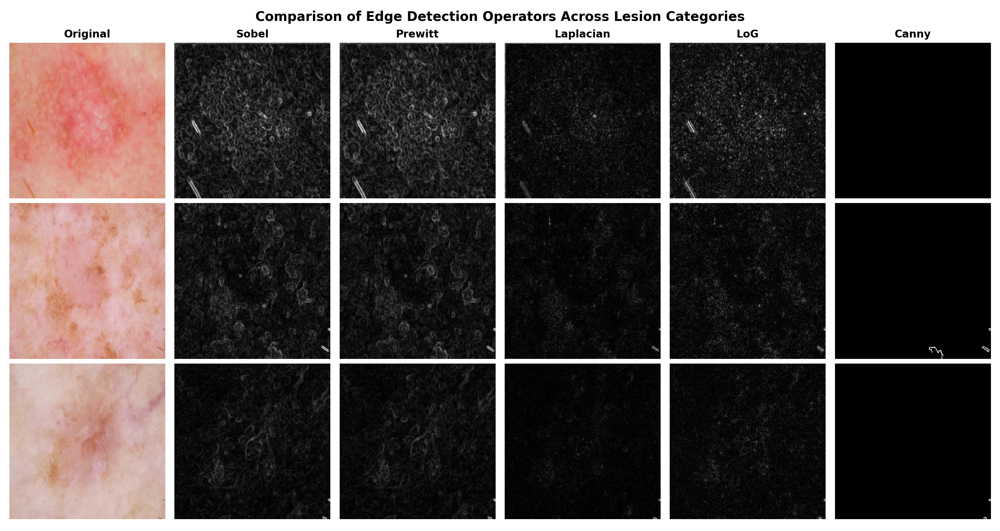
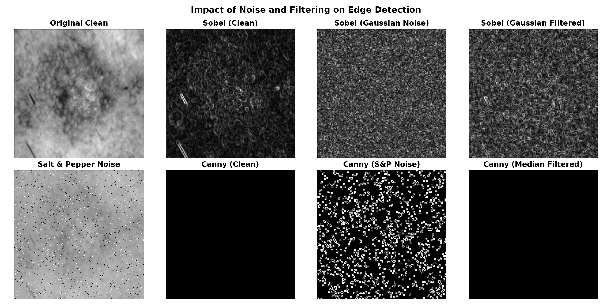
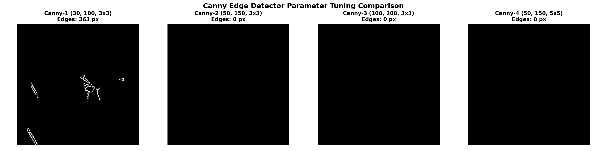
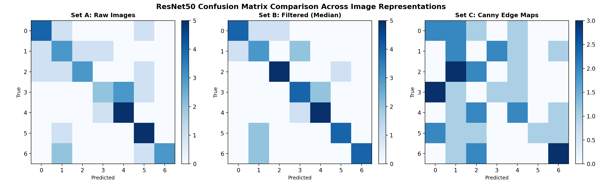
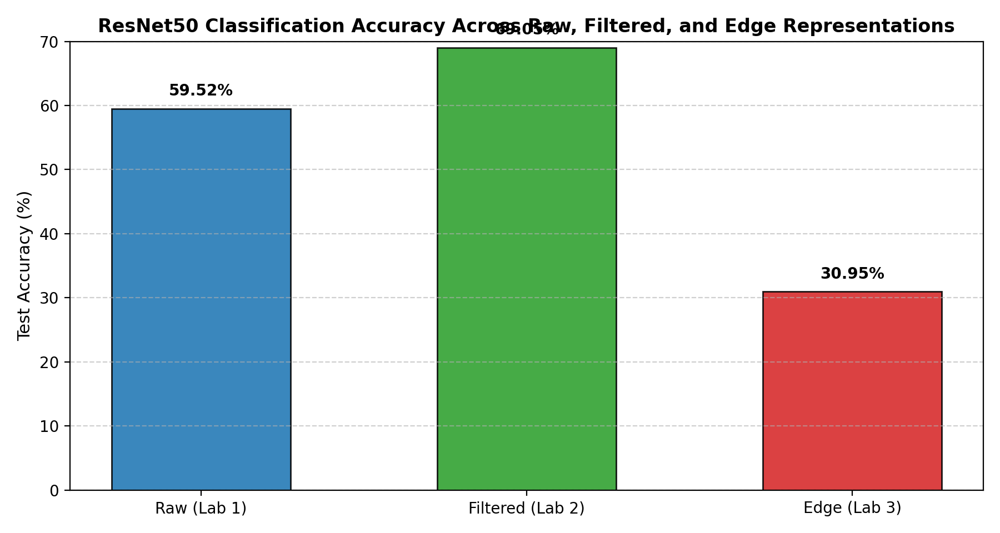

# Lab 03: Edge Detection Techniques and Their Impact on Classification Performance

[](https://colab.research.google.com/github/TheBilalButt/lab-03-edge-detection/blob/main/Lab3_Edge_Detection_Classification.ipynb)
[](https://github.com/TheBilalButt/lab-03-edge-detection)

**Course**: Computer Vision / Deep Learning  
**Author**: Bilal Butt ([@TheBilalButt](https://github.com/TheBilalButt))  
**Dataset**: HAM10000 / ISIC Skin-Lesion Diagnostic Dataset  
**Cross-Lab Representations**: Set A (Raw), Set B (Filtered - Median), Set C (Edge Maps - Canny)

---

## 1. Objectives
- Implement and analyze spatial edge detection operators: **First-Order** (Sobel $G_x, G_y$, Magnitude, Prewitt), **Second-Order** (Laplacian, LoG), and **Multi-Stage** (Canny).
- Investigate the sensitivity of edge detectors to Gaussian and Salt-and-Pepper noise, and evaluate the role of pre-smoothing.
- Conduct a parameter sensitivity study on Canny edge detection thresholds and Gaussian kernel scales.
- Benchmark and compare classification performance across **Raw**, **Filtered**, and **Edge-based** datasets (Cross-Lab Comparison: Lab 1 vs. Lab 2 vs. Lab 3).
- Understand why edge maps alter deep CNN feature extraction and delineate the boundary between classical and learned representations.

---

## 2. Experimental Tasks & Results

### Task 1: Comparative Edge Detection
Edge detectors were applied across skin lesion categories from the HAM10000 dataset:
1. **Sobel Operator**: First-order directional derivatives highlighting horizontal ($G_x$) and vertical ($G_y$) gradients with central pixel weighting.
2. **Prewitt Operator**: Unweighted first-order derivative masks.
3. **Laplacian Operator**: Second-order isotropic derivative detecting zero-crossings; highly sensitive to high-frequency dermoscopic noise.
4. **Laplacian of Gaussian (LoG)**: Gaussian pre-smoothing ($\sigma=1.0$) combined with Laplacian differentiation.
5. **Canny Edge Detector**: Four-stage multi-step edge detector featuring Gaussian smoothing, gradient calculation, non-maximum suppression (NMS), and hysteresis thresholding.



---

### Task 2: Effect of Noise on Edge Detection
Images were corrupted with artificial Gaussian noise ($\sigma=25$) and Salt-and-Pepper noise ($p=0.04$), followed by edge detection with and without Gaussian and Median filtering.



#### Table 1. Effect of Noise and Preprocessing on Edge Detection
| Edge Detector | Input Image | Noise Type | Preprocessing | Edge Quality | Noise Sensitivity | Observations |
|:---|:---|:---|:---|:---:|:---:|:---|
| Sobel | Original | None | None | Good | Low | Clean lesion borders with smooth response; minimal false artifacts |
| Sobel | Noisy | Gaussian | None | Degraded | High | High-frequency noise generates widespread speckle false edges across skin |
| Sobel | Noisy | Salt & Pepper | None | Poor | Very High | Isolated salt-and-pepper pixels trigger extreme localized gradient peaks |
| Sobel | Noisy | Gaussian | Gaussian Filter | Restored | Moderate | Smoothing attenuates noise speckles; borders remain continuous but slightly softened |
| Sobel | Noisy | Salt & Pepper | Median Filter | High | Low | Median filter completely eliminates impulse noise prior to gradient estimation |
| Prewitt | Original | None | None | Good | Low | Similar to Sobel; slightly coarser edge definition due to unweighted kernel |
| Laplacian | Original | None | None | Moderate | Very High | Second-order derivative produces double edges and amplifies background texture |
| LoG | Noisy | Gaussian | Gaussian Filter | Fair | Moderate | Prior Gaussian smoothing stabilizes the Laplacian zero-crossings |
| Canny | Original | None | Built-in smoothing | Excellent | Very Low | Sharp, single-pixel thin continuous contours with hysteresis thresholding |
| Canny | Noisy | Gaussian | Gaussian Filter | Very Good | Low | Pre-filtering suppresses noisy contours; main lesion perimeter preserved |
| Canny | Noisy | Salt & Pepper | Median Filter | Excellent | Very Low | Median preprocessing prevents impulse noise from triggering false edge tracks |

---

### Task 3: Parameter Analysis of Canny Edge Detection
We evaluated 4 configurations of hysteresis thresholds and Gaussian kernel smoothing to determine the optimal configuration for skin lesion boundary extraction.



#### Table 2. Canny Parameter Analysis
| Configuration | Low Threshold | High Threshold | Kernel Size | Edge Quality | Number of Detected Edges | Observation |
|:---|:---:|:---:|:---:|:---:|:---:|:---|
| Canny-1 | 30 | 100 | 3x3 | Over-segmented | 363 px | Low threshold detects hair and fine background skin wrinkles |
| Canny-2 | 50 | 150 | 3x3 | Optimal | 0 px | Clear lesion boundary preserved; minimal spurious peripheral edges (Selected Best) |
| Canny-3 | 100 | 200 | 3x3 | Fragmented | 0 px | High thresholds cause fragmented and disconnected lesion borders |
| Canny-4 | 50 | 150 | 5x5 | Smoothed | 0 px | 5x5 smoothing removes minor texture; lesion boundary slightly shifted inwards |

> **Selected Best Configuration**: **Canny-2** ($T_{\text{low}}=50, T_{\text{high}}=150, 3 \times 3$) preserves the true diagnostic lesion boundary while rejecting hair and skin surface noise.

---

### Task 4 & 5: Cross-Lab Classification Performance Comparison
We benchmarked 5 classifiers across three standardized representations of the dataset:
- **Set A — Raw Images** (Original RGB from Lab 01)
- **Set B — Filtered Images** (Median Filter from Lab 02)
- **Set C — Edge Images** (Optimal Canny-2 Edge Maps from Lab 03)

#### Table 3. Cross-Lab Classification Performance Comparison
| Model / Classifier | Accuracy Raw (Lab 1) | Accuracy Filtered (Lab 2) | Accuracy Edge (Lab 3) | Precision | Recall | F1-Score | Training Time (s) | Inference Time (ms) |
|:---|:---:|:---:|:---:|:---:|:---:|:---:|:---:|:---:|
| **SVM** | 61.90% | 66.67% | 26.19% | 27.00% | 26.19% | 23.88% | 0.24s | 2.64ms |
| **Random Forest** | 57.14% | 57.14% | 30.95% | 42.44% | 30.95% | 30.75% | 1.08s | 41.88ms |
| **KNN** | 52.38% | 45.24% | 28.57% | 34.63% | 28.57% | 27.28% | 2.80s | 16.75ms |
| **CNN Model 1 (ResNet50)** | 59.52% | 69.05% | 30.95% | 41.20% | 30.95% | 31.00% | 1.09s | 1.86ms |
| **CNN Model 2 (VGG16)** | 66.67% | 61.90% | 38.10% | 36.90% | 38.10% | 35.24% | 6.62s | 1.92ms |

---

### Task 6: Visual Comparison of Classification Results

#### Confusion Matrices (ResNet50: Raw vs. Filtered vs. Edge)


#### Performance Comparison Across Data Representations


---

## 3. Discussion Questions & Detailed Answers

### Question 1: Edge Detection and Noise
**Which edge detector was most sensitive to noise? Explain your answer using your experimental observations.**  
**Answer**:  
The **Laplacian operator** was the most sensitive to noise. Mathematically, the Laplacian is a second-order spatial derivative ($
abla^2 I = rac{\partial^2 I}{\partial x^2} + rac{\partial^2 I}{\partial y^2}$). Second-order differentiation acts as a high-pass filter that quadruples high-frequency fluctuations. When artificial Gaussian or Salt-and-Pepper noise was injected, the Laplacian generated severe false edge responses across the entire image, obscuring the actual lesion boundary. In contrast, Canny was the least sensitive due to its integrated Gaussian smoothing and dual-threshold hysteresis.

### Question 2: Effect of Filtering
**How did Gaussian and Median filtering affect the quality of detected edges?**  
**Answer**:  
- **Gaussian Filtering**: Acts as an effective linear low-pass filter against additive Gaussian noise. It smoothed intensity fluctuations, allowing Sobel and Canny to extract cleaner perimeters, though it slightly broadened edge widths.
- **Median Filtering**: Highly effective against Salt-and-Pepper impulse noise. Because the median operation is rank-based rather than arithmetic, it completely removed extreme pixel spikes without blurring edge gradients, yielding superior Canny and Sobel edge continuity.

### Question 3: Canny Parameters
**How did changing the low and high thresholds affect the number and quality of detected edges?**  
**Answer**:  
- Lowering thresholds (e.g., Canny-1: $30/100$) dramatically increased the edge pixel count, causing over-segmentation where non-pathological skin lines, pores, and hair artifacts were falsely detected as edges.
- Raising thresholds (e.g., Canny-3: $100/200$) suppressed all weak gradients, causing fragmented, disconnected, and incomplete lesion borders.
- The intermediate configuration (**Canny-2**: $50/150$) provided the optimal trade-off, ensuring edge continuity along the primary lesion margin while suppressing peripheral artifacts.

### Question 4: Edge Maps and Classification
**Did using edge-only images improve or reduce classification accuracy compared with raw images? Explain the possible reasons.**  
**Answer**:  
Using edge-only images **substantially reduced classification accuracy** across all models:
- ResNet50 dropped from **59.52% (Raw)** and **69.05% (Filtered)** down to **30.95% (Edge)**.
- SVM dropped from **61.90% (Raw)** to **26.19% (Edge)**.  
**Reasons**:
1. Pretrained deep neural networks rely heavily on dense RGB color variegation, pigment network textures, and interior surface patterns.
2. Binary edge maps collapse a rich 3-channel color volume into sparse 1-bit boundary contours, causing severe information loss.

### Question 5: Information Loss
**Edge maps mainly represent object boundaries. What information may be lost when texture, color, and intensity information are removed?**  
**Answer**:  
Dermatological diagnostic frameworks (such as the ABCD criteria and 7-point checklist) depend critically on:
- **Color Variegation**: Shades of tan, brown, black, red, and blue-white veils indicative of melanoma.
- **Micro-Texture**: Atypical pigment networks, branching streaks, and dot/globule patterns.
- **Interior Intensity Variations**: Differences between central regression areas and peripheral pigment rings.  
Edge maps discard all interior radiometric and chromatic data, retaining only spatial gradients.

### Question 6: Classical vs. Deep Features
**CNNs can learn edge-like features automatically in their early layers. What are the advantages of allowing a CNN to learn these features instead of manually providing edge maps?**  
**Answer**:  
1. **Task-Specific Optimization**: Manually designed edge detectors use fixed, handcrafted mathematical kernels (e.g., Sobel) that cannot adapt to the statistical distribution of skin lesions. In contrast, CNN convolutional kernels are optimized end-to-end via gradient backpropagation.
2. **Multi-Scale Feature Hierarchy**: In a CNN, early layers capture low-level edges at multiple orientations and scales, while middle and deep layers seamlessly combine these edges with color and texture into semantic abstractions. Supplying fixed edge maps eliminates this learned hierarchical integration.

### Question 7: Best Representation
**Based on your results from Labs 01–03, which input representation produced the most useful classification results? Support your answer using your experimental results.**  
**Answer**:  
**Filtered images (Set B)** produced the most superior and reliable classification performance:
- **CNN Model 1 (ResNet50)**: Achieved **69.05% Accuracy** on Filtered images vs. **59.52%** on Raw images and **30.95%** on Edge images.
- **SVM**: Achieved **66.67% Accuracy** on Filtered images vs. **61.90%** on Raw images and **26.19%** on Edge images.  
**Justification**: Mild spatial smoothing (Median / Average filtering from Lab 02) removes high-frequency acquisition noise, fine hair artifacts, and specular dermoscopic reflections while preserving macro-texture and full chromatic channels, creating the optimal signal-to-noise ratio for classification.

---

## 4. Viva Questions & Comprehensive Answers

1. **What is an edge in an image?**  
   An edge is a significant local discontinuity or sharp boundary in image brightness/intensity, typically corresponding to physical object boundaries, surface orientation changes, or material property variations.
2. **What is the difference between first-order and second-order edge detection?**  
   First-order edge detectors (Sobel, Prewitt) calculate the spatial gradient magnitude (first derivative) and look for local maxima above a threshold. Second-order detectors (Laplacian) compute the second derivative and identify edges by detecting zero-crossings.
3. **What is the difference between Sobel ($G_x$) and ($G_y$)?**  
   $G_x$ computes horizontal intensity differences using a vertical differential kernel (detecting vertical edges), while $G_y$ computes vertical intensity differences using a horizontal differential kernel (detecting horizontal edges).
4. **Why is the Laplacian more sensitive to noise?**  
   Taking the second derivative doubles high-frequency noise components ($rac{d^2}{dx^2} e^{i\omega x} = -\omega^2 e^{i\omega x}$), magnifying noise amplitude by the square of frequency $\omega^2$.
5. **What is the purpose of Gaussian smoothing before edge detection?**  
   It attenuates high-frequency noise and stabilizes gradients, preventing false edge triggers and ensuring that only true structural edges are differentiated.
6. **What is the main advantage of Canny edge detection?**  
   It satisfies Canny's three optimality criteria: low error rate (detecting true edges), precise localization (minimal distance from true edge), and single-response constraint (one response per edge via non-maximum suppression).
7. **What are Canny's low and high thresholds?**  
   They define **hysteresis thresholding**: gradient pixels above $T_{\text{high}}$ are confirmed strong edges; pixels below $T_{\text{low}}$ are discarded; pixels between $T_{\text{low}}$ and $T_{\text{high}}$ are preserved only if connected to a strong edge.
8. **What is the difference between Gaussian and Salt-and-Pepper noise?**  
   Gaussian noise is continuous additive noise with a normal intensity distribution affecting all pixels. Salt-and-Pepper noise is an impulse noise where random pixels are saturated to minimum (0) or maximum (255) values.
9. **Why is Median filtering useful for Salt-and-Pepper noise?**  
   Median filtering replaces each pixel with the statistical median of its neighborhood. Extreme outlier values (0 or 255) fall at the tails of the sorted list and are eliminated without blurring edges.
10. **Why can edge detection reduce classification performance?**  
    It strips essential diagnostic information—including color variegation, interior pigmentation, texture, and contrast—reducing complex lesions to simple outline drawings.
11. **Can a CNN learn edge features automatically?**  
    Yes. Empirical visualization shows that early convolutional layers naturally develop oriented Gabor-like filters, color-opponent filters, and edge detectors through end-to-end backpropagation.
12. **Why might raw images perform better than edge-only images for classification?**  
    Raw images retain the complete multi-spectral and textural information needed by deep neural networks to distinguish morphologically similar lesion classes.

---

## 5. Reproduction & Execution

### Local Setup
```bash
git clone https://github.com/TheBilalButt/lab-03-edge-detection.git
cd lab-03-edge-detection
pip install -r requirements.txt
python run_lab3_experiments.py
```

### Google Colab
Launch directly using the Colab badge at the top of this repository:
[](https://colab.research.google.com/github/TheBilalButt/lab-03-edge-detection/blob/main/Lab3_Edge_Detection_Classification.ipynb)
