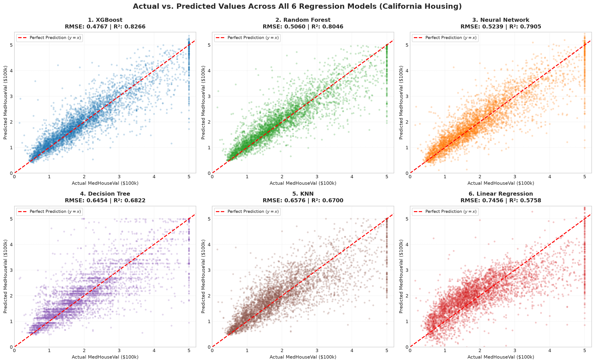
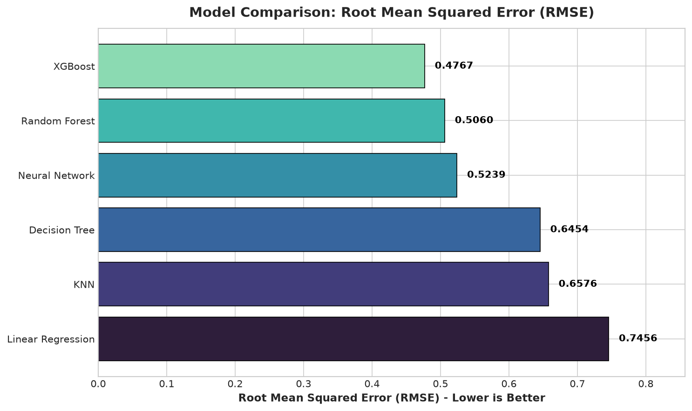
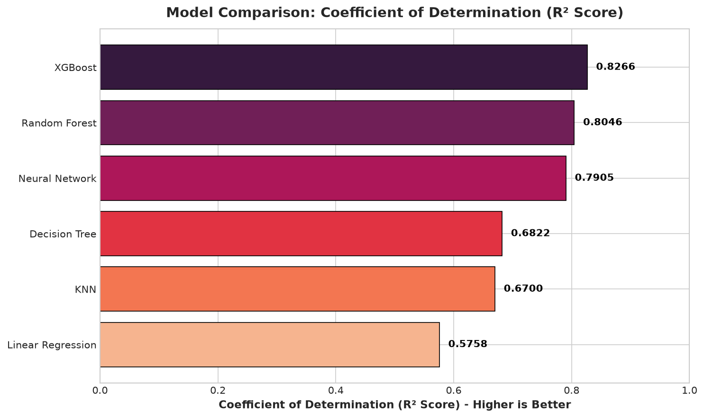
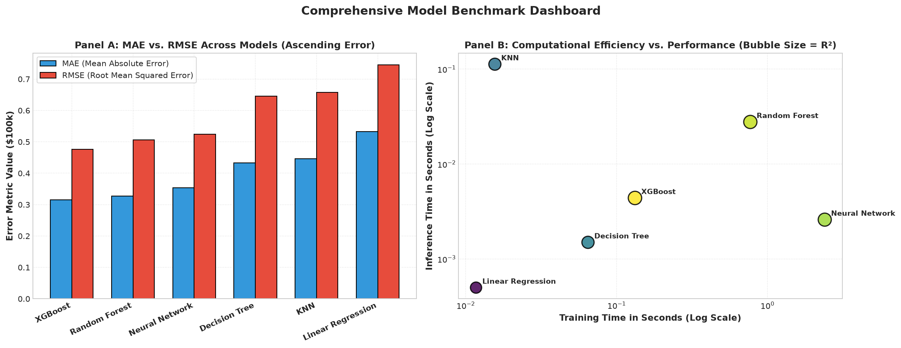

# Lab 10: Model Training - Comparative Machine Learning Regression

[](https://colab.research.google.com/github/TheBilalButt/Computer-Vision-Labs/blob/main/Lab-10-Model-Training/Lab10_Model_Training.ipynb)


> **Course:** Computer Vision / Machine Learning Laboratory Portfolio  
> **Lab:** Lab 10 — Model Training: Comparative Machine Learning Regression  
> **Author:** Muhammad Bilal Butt (Roll Number: 42)  
> **Institution:** BS Artificial Intelligence, Department of Computer Science  
> **Dataset:** California Housing Dataset (Scikit-Learn) — 20,640 samples, 8 input features, continuous target `MedHouseVal`  
> **Interactive Notebook:** [`Lab10_Model_Training.ipynb`](Lab10_Model_Training.ipynb) / [`Comparative_Machine_Learning_Regression.ipynb`](Comparative_Machine_Learning_Regression.ipynb)  

---

## 📌 Executive Summary

This repository presents an empirical comparative benchmark of **six core regression algorithms** evaluated under standardized, leak-free experimental conditions on the California Housing dataset. 

Every model was trained and tested on the exact same 80/20 train-test split (`random_state=42`). `StandardScaler` was fit strictly on training data to prevent data leakage and applied selectively to distance-sensitive and gradient-based algorithms (Linear Regression, MLP, KNN), while tree-based ensembles (Decision Tree, Random Forest, XGBoost) were evaluated on original feature representations.

---

## 🏆 Final Benchmark Results

The table below reflects the actual empirical metrics obtained across the 4,128 unseen test instances, sorted by **RMSE ascending** (best model first):

| Rank | Algorithm | MAE | MSE | RMSE | R² Score | Train Time (s) | Pred Time (s) |
| :---: | :--- | :---: | :---: | :---: | :---: | :---: | :---: |
| 🥇 | **XGBoost Regressor** | **0.3155** | **0.2273** | **0.4767** | **0.8266** | 0.132s | 0.004s |
| 🥈 | **Random Forest Regressor** | 0.3277 | 0.2560 | 0.5060 | 0.8046 | 0.769s | 0.028s |
| 🥉 | **Neural Network (MLP)** | 0.3533 | 0.2745 | 0.5239 | 0.7905 | 2.395s | 0.003s |
| 4 | **Decision Tree Regressor** | 0.4335 | 0.4165 | 0.6454 | 0.6822 | 0.065s | 0.002s |
| 5 | **K-Nearest Neighbors (KNN)** | 0.4462 | 0.4324 | 0.6576 | 0.6700 | **0.016s** | 0.113s |
| 6 | **Linear Regression (OLS)** | 0.5332 | 0.5559 | 0.7456 | 0.5758 | 0.012s | **0.001s** |

*All metrics rounded to 4 decimal places. Target unit is $100,000 USD.*

---

## 🔬 Core Insights & Key Findings

1. **Consistent Hierarchy Across All Metrics:**
   The algorithm performance order is 100% consistent across MAE, MSE, RMSE, and $R^2$:
   $$\text{XGBoost} \succ \text{Random Forest} \succ \text{Neural Network (MLP)} \succ \text{Decision Tree} \succ \text{KNN} \succ \text{Linear Regression}$$

2. **Why XGBoost Won:**
   - **Second-Order Loss Optimization:** Utilizes both first-order gradients and second-order Hessians.
   - **Regularization ($L_1 / L_2$):** Penalizes leaf weights to prevent overfitting on spatial coordinates (`Latitude`, `Longitude`).
   - **Non-Linear Geographic Capture:** Effectively models high-value coastal property clusters.

3. **Ensemble Power (Bagging vs. Boosting):**
   - Both **XGBoost ($R^2 = 0.8266$)** and **Random Forest ($R^2 = 0.8046$)** significantly outshine individual base learners. Random Forest reduces variance through bagging, while XGBoost sequentially reduces bias and residual errors.

4. **Lazy Learning Overhead in KNN:**
   - KNN required virtually zero training time (0.016s) but exhibited the **highest prediction latency (0.113s)** because distance calculations must be performed against all 16,512 training instances during test-time inference.

5. **The Interpretability vs. Accuracy Trade-Off:**
   - **Linear Regression ($R^2 = 0.5758$):** Highly interpretable; coefficients directly quantify marginal feature contributions (e.g., impact of median income).
   - **XGBoost ($R^2 = 0.8266$):** A complex ensemble "black box". Highly optimal for automated valuation systems, whereas Linear Regression remains critical for audited regulatory and lending compliance.

---

## 📊 Visualizations

### 1. Actual vs Predicted Values (2x3 Subplot Grid)
Examining alignment along the ideal $y = x$ reference line (red dashed line):


### 2. Metric Comparisons (RMSE & R² Score)
| RMSE Comparison (Lower is Better) | R² Score Comparison (Higher is Better) |
| :---: | :---: |
|  |  |

### 3. Model Benchmark Dashboard (Error vs Computational Efficiency)


---

## 🗂️ Lab Directory Structure

```
Lab-10-Model-Training/
├── Lab10_Model_Training.ipynb                     # Google Colab / Jupyter Notebook (19 Sections)
├── Comparative_Machine_Learning_Regression.ipynb  # Complete Notebook (Mirror)
├── train_and_evaluate.py                          # Standalone CLI Python pipeline script
├── create_notebook.py                             # Script to generate / execute the notebook
├── requirements.txt                               # Environment dependencies
├── README.md                                      # Lab report & documentation
└── visualizations/                                # High-resolution evaluation charts
    ├── actual_vs_predicted_2x3.png
    ├── rmse_comparison_bar.png
    ├── r2_comparison_bar.png
    └── model_comparison_dashboard.png
```

---

## 🚀 Quickstart & Execution

### Option 1: Run in Google Colab
Click the badge at the top or open [`Lab10_Model_Training.ipynb`](https://colab.research.google.com/github/TheBilalButt/Computer-Vision-Labs/blob/main/Lab-10-Model-Training/Lab10_Model_Training.ipynb) directly in Google Colab. All sections run out of the box with zero additional configuration.

### Option 2: Run Locally via Python CLI

```bash
# Navigate to the lab folder inside the repository
cd Lab-10-Model-Training

# Install dependencies
pip install -r requirements.txt

# Run the benchmark script
python train_and_evaluate.py
```

---

## 🎓 Viva Preparation Questions & Answers

<details>
<summary><b>Q1: Why did you fit StandardScaler only on the training set?</b></summary>
Fitting the scaler on the entire dataset or test set introduces <i>data leakage</i>. The mean and standard deviation of unseen test data would bleed into the training pipeline, leading to overly optimistic and invalid generalization scores.
</details>

<details>
<summary><b>Q2: Why do tree-based models not require feature scaling?</b></summary>
Decision trees, Random Forests, and XGBoost determine splitting points by evaluating monotonic coordinate thresholds ($x_j \le \theta$) that maximize information gain or variance reduction. Monotonic linear or affine transformations do not alter the ordering of values, making scaling redundant for tree algorithms.
</details>

<details>
<summary><b>Q3: Why does KNN have such high prediction latency compared to Neural Networks?</b></summary>
KNN is a non-parametric lazy learner. It stores all training instances without learning explicit parametric weights. At inference time, it must compute Euclidean distances against all 16,512 training vectors for each of the 4,128 test instances ($O(N_{\text{test}} \cdot N_{\text{train}} \cdot d)$). Conversely, a trained MLP evaluates predictions via simple matrix multiplications ($O(d \cdot h_1 + h_1 \cdot h_2)$).
</details>

<details>
<summary><b>Q4: Why does Linear Regression underperform on the California Housing dataset?</b></summary>
California house prices have strong non-linear interactions, notably geographical proximity to coastal areas and urban centers (`Latitude` and `Longitude` interactions), which linear hyperplanes cannot model without manual polynomial or spatial feature engineering.
</details>

---

## 📄 License
This project is open-source under the MIT License.
