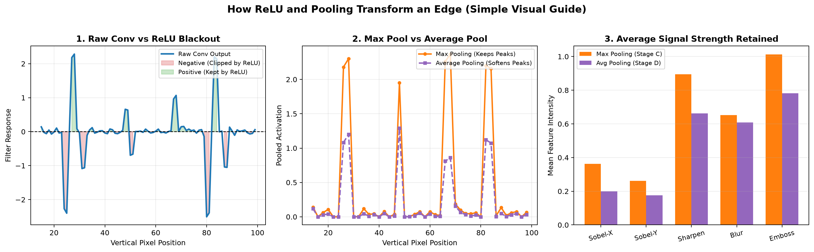
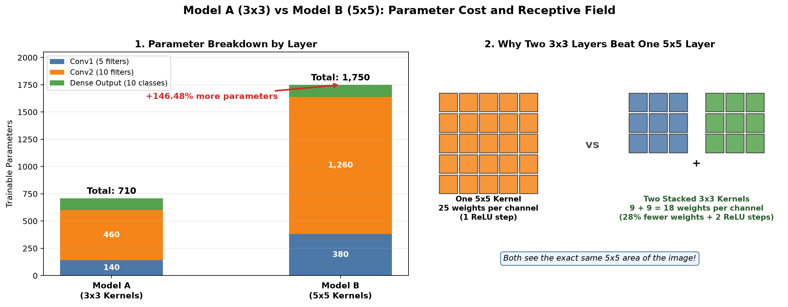

# Lab 12: CNN Feature Visualization, Parameter Audit, and Critical Analysis

## What This Lab Is About

When a Convolutional Neural Network (CNN) looks at an image, it does not see a building or a window all at once. Instead, it passes the image through a series of small filters, cleans up the signal, and shrinks the image step by step so it can focus on the most important shapes.

In this lab, we build that exact pipeline from scratch using five classic `3x3` filters and watch how each step changes the image. We also compare two small CNN models by hand and verify our math with TensorFlow.

## Files in This Folder

- [`Lab12_CNN_Feature_Visualization.ipynb`](Lab12_CNN_Feature_Visualization.ipynb): Ready-to-run Google Colab notebook (clean code, no comments).
- [`lab12_cnn_visualization.py`](lab12_cnn_visualization.py): Standalone Python script that generates all grids, charts, and model summaries.
- [`visualizations/input_architecture.png`](visualizations/input_architecture.png): High-contrast 256x256 architectural test image.
- [`visualizations/part1_5x4_feature_grid.png`](visualizations/part1_5x4_feature_grid.png): Full 5x4 grid showing all 5 filters across 4 stages.
- [`visualizations/part1_layman_relu_pooling_explainer.png`](visualizations/part1_layman_relu_pooling_explainer.png): Visual breakdown of how ReLU and Pooling transform an edge.
- [`visualizations/part2_parameter_comparison_chart.png`](visualizations/part2_parameter_comparison_chart.png): Visual comparison of Model A vs Model B parameters and receptive fields.
- [`visualizations/part2_model_summaries.txt`](visualizations/part2_model_summaries.txt): Raw `model.summary()` output from TensorFlow.

---

## Part I: Watching Five Filters Across Four Stages

We pass a crisp architectural image through five `3x3` filters and inspect four stages for each:

1. **Stage A (Raw Convolution):** The direct output of sliding the filter over the image. It can contain both positive values (bright red) and negative values (deep blue).
2. **Stage B (Post-ReLU):** Applies `ReLU(x) = max(0, x)`. Anything negative is turned into `0` (pure black).
3. **Stage C (Max Pooling, 2x2, stride 2):** Shrinks the image by half by picking the brightest pixel in each `2x2` block.
4. **Stage D (Average Pooling, 2x2, stride 2):** Shrinks the image by half by averaging each `2x2` block.

### The 5x4 Feature Map Grid

### How ReLU and Pooling Work (Visual Guide)

If the 5x4 grid feels dense at first glance, the chart below zooms in on a single vertical slice of the building to show what is happening:

- **Left:** In Raw Conv, edges create both positive spikes (green) and negative dips (red). ReLU simply chops off everything below zero.
- **Middle:** Max Pooling rides along the top of the spikes, keeping sharp edges bright. Average Pooling pulls those spikes down by averaging them with dark neighbors.
- **Right:** Across all five filters, Max Pooling consistently retains stronger signal intensity than Average Pooling.

### Measured Statistics from Our Run

| Filter (Row) | Stage A Range | Negative Pixels (`< 0`) | Stage B Blackout (`== 0`) | Stage C Mean (MaxPool) | Stage D Mean (AvgPool) |
| :--- | :---: | :---: | :---: | :---: | :---: |
| **1. Horizontal Edge (Sobel-X)** | `[-3.14, 3.03]` | 49.1% | 49.1% | 0.362 | 0.199 |
| **2. Vertical Edge (Sobel-Y)** | `[-3.04, 3.06]` | 48.6% | 48.6% | 0.261 | 0.176 |
| **3. Sharpen Kernel** | `[-1.47, 2.38]` | 14.4% | 14.4% | 0.895 | 0.662 |
| **4. Gaussian Blur (3x3)** | `[0.10, 0.97]` | 0.0% | 0.0% | 0.653 | 0.608 |
| **5. Emboss Kernel** | `[-2.84, 3.16]` | 13.4% | 13.4% | 1.012 | 0.782 |

---

## Part II: Model A vs Model B Parameter Audit

Both models take a `32 x 32 x 3` RGB image and pass it through `Conv1` (5 filters), `Pool1` (2x2, stride 2), `Conv2` (10 filters), `Pool2` (2x2, stride 2), `GlobalAveragePooling2D`, and a 10-class `Dense` output layer.

The formula for trainable parameters in any convolutional layer is:

$$\text{Trainable Parameters} = (K_h \times K_w \times C_{\text{in}} + 1) \times C_{\text{out}}$$

### Step-by-Step Hand Calculations

#### Model A (Standard: `3x3` Kernels, Max Pooling)
1. **Conv1** ($K_h=3, K_w=3, C_{\text{in}}=3, C_{\text{out}}=5$):
   $(3 \times 3 \times 3 + 1) \times 5 = (27 + 1) \times 5 = 28 \times 5 = \mathbf{140}$
2. **Pool1 (MaxPool 2x2, stride 2):** $\mathbf{0}$ (pooling has no learnable weights)
3. **Conv2** ($K_h=3, K_w=3, C_{\text{in}}=5, C_{\text{out}}=10$):
   $(3 \times 3 \times 5 + 1) \times 10 = (45 + 1) \times 10 = 46 \times 10 = \mathbf{460}$
4. **Pool2 (MaxPool 2x2, stride 2):** $\mathbf{0}$
5. **GlobalAveragePooling2D:** $\mathbf{0}$ (averages each of the 10 feature maps into 1 number)
6. **Dense Output (10 units):**
   $(10 + 1) \times 10 = 11 \times 10 = \mathbf{110}$
- **Total Model A Parameters:** $140 + 460 + 110 = \mathbf{710}$

#### Model B (Large Kernel: `5x5` Kernels, Average Pooling)
1. **Conv1** ($K_h=5, K_w=5, C_{\text{in}}=3, C_{\text{out}}=5$):
   $(5 \times 5 \times 3 + 1) \times 5 = (75 + 1) \times 5 = 76 \times 5 = \mathbf{380}$
2. **Pool1 (AvgPool 2x2, stride 2):** $\mathbf{0}$
3. **Conv2** ($K_h=5, K_w=5, C_{\text{in}}=5, C_{\text{out}}=10$):
   $(5 \times 5 \times 5 + 1) \times 10 = (125 + 1) \times 10 = 126 \times 10 = \mathbf{1,260}$
4. **Pool2 (AvgPool 2x2, stride 2):** $\mathbf{0}$
5. **GlobalAveragePooling2D:** $\mathbf{0}$
6. **Dense Output (10 units):**
   $(10 + 1) \times 10 = 11 \times 10 = \mathbf{110}$
- **Total Model B Parameters:** $380 + 1,260 + 110 = \mathbf{1,750}$

### Audit Verification Table

| Model Configuration | Conv Architecture | Kernel Size | Pooling Type | Manual Count | Code Output |
| :--- | :--- | :---: | :--- | :---: | :---: |
| **Model A (Standard)** | Conv1: 5 filters, Conv2: 10 filters | `3 x 3` | Max Pooling (`2 x 2`, stride 2) | **710** | **710** |
| **Model B (Large Kernel)** | Conv1: 5 filters, Conv2: 10 filters | `5 x 5` | Avg Pooling (`2 x 2`, stride 2) | **1,750** | **1,750** |

---

## Part III: Critical Thinking and Viva Defense Answers (Handwritten Guide)

### Question 1: The ReLU "Blackout" Effect and Activation Alternatives
- **What turned black in our 5x4 grid (Rows 1 and 2, Stage A vs Stage B):**
  - In **Row 1 (Horizontal Edge / Sobel-X)**, **49.1%** of the pixels turned completely black (`0.00`) after ReLU. Specifically, the **top edges of the dark window recesses** and the **bottom edges of the bright floor slabs** (where brightness drops from light to dark going downward, shown in blue down to `-3.14` in Stage A) were wiped out.
  - In **Row 2 (Vertical Edge / Sobel-Y)**, **48.6%** of the pixels turned completely black after ReLU. Specifically, the **right edges of bright vertical pillars** and **left edges of dark windows** (where brightness drops from light to dark going rightward, shown in blue down to `-3.04` in Stage A) were wiped out.
- **Why those pixels were negative:** Edge filters have weights that sum to zero (`[-1, -2, -1]` on one side and `[+1, +2, +1]` on the other). When bright pixels sit under the negative side and dark pixels sit under the positive side, the result is negative. ReLU clips all negative numbers to zero.
- **Leaky ReLU ($\alpha = 0.1$) vs Sigmoid:**
  - **Leaky ReLU** ($f(x) = x$ if $x > 0$, else $0.1x$) keeps a small fraction of those negative edges visible (for example, `-3.14` becomes `-0.314`) instead of turning them pitch black, which helps gradients keep flowing during training.
  - **Sigmoid** ($\sigma(x) = \frac{1}{1 + e^{-x}}$) squashes every value between `0` and `1`. Flat areas with `0` edge response become `0.5` (mid-gray instead of black), positive edges approach `1.0`, and negative edges approach `0.0`, which softens contrast and can cause vanishing gradients.

---

### Question 2: Max Pooling vs Average Pooling Information Retention
- **What we saw in our grid (Rows 1 to 3, Stage C vs Stage D):**
  - Across **Row 3 (Sharpen)** and **Rows 1 and 2 (Edges)**, **Stage C (Max Pooling)** kept the thin, high-frequency **window crossbars** and **sharp building edges** bright and crisp (Sharpen mean `0.895`, Horizontal Edge mean `0.362`).
  - Under **Stage D (Average Pooling)**, those thin lines became faded and washed out because each bright edge pixel was averaged with dark neighboring background pixels (dropping Sharpen mean to `0.662` and Horizontal Edge mean to `0.199`).
- **Dark ink text on a pure white background (values near 255):**
  - Here the background is bright (`255`) and the text strokes are dark (`~0`). **Max Pooling** would pick the `255` white background pixel in almost every `2x2` window and **erase the dark text**.
  - **Average Pooling** would preserve the text strokes much better by blending dark ink with white paper into visible gray strokes (or you could invert the image first and then use Max Pooling).

---

### Question 3: Parameter Explosion and Receptive Field Equivalence
- **Percentage increase from Model A to Model B:**
  $$\text{Increase} = \frac{1,750 - 710}{710} \times 100\% = \frac{1,040}{710} \times 100\% = \mathbf{146.48\%}$$
- **Matching a `5x5` receptive field using `3x3` layers:**
  - You need **2 stacked `3x3` layers** (with stride 1). The first layer looks at a `3x3` patch, and the second layer looks at a `3x3` patch of that output, covering $3 + (3 - 1) = \mathbf{5 \times 5}$ pixels of the original image.
  - **Parameters saved:** A single `5x5` layer with $C$ channels uses $25C^2$ weights, while two `3x3` layers use $2 \times 9C^2 = 18C^2$ weights. That saves **28% of the weights** while adding an extra ReLU non-linearity. For our Model B `Conv2` (`5` to `10` channels, `1,260` params), two stacked `3x3` layers (`5→5→10`) use `(45+1)*5 + (45+1)*10 = 690` params, saving **570 parameters (45.2%)**.

---

### Question 4: Operation Commutativity (Order Invariance)
- **Are the outputs identical or different?**
  They are **identical**. `Conv → ReLU → MaxPool` and `Conv → MaxPool → ReLU` produce the exact same numbers because `ReLU(x) = max(0, x)` is monotonically non-decreasing.
- **Proof on a `2x2` patch with negative numbers:**
  Let $P = \begin{bmatrix} -4 & -1 \\ -3 & 2 \end{bmatrix}$:
  - **Order 1 (`ReLU → MaxPool`):** $\text{ReLU}(P) = \begin{bmatrix} 0 & 0 \\ 0 & 2 \end{bmatrix} \implies \text{MaxPool} = \max(0, 0, 0, 2) = \mathbf{2}$.
  - **Order 2 (`MaxPool → ReLU`):** $\text{MaxPool}(P) = \max(-4, -1, -3, 2) = 2 \implies \text{ReLU}(2) = \mathbf{2}$.
  Even if all numbers are negative (e.g., `[-5, -2; -8, -1]`), Order 1 gives `max(0,0,0,0) = 0` and Order 2 gives `ReLU(-1) = 0`.
- **Computational efficiency:**
  `Conv → MaxPool → ReLU` is **faster and cheaper**. Max Pooling shrinks the feature map to **25% of its size** (since 2x2 stride 2 cuts height and width in half), so ReLU only has to process one quarter as many numbers.

---

### Question 5: Diagnosing Filter Redundancy (Debugging Scenario)
1. **Root Cause 1: Identical / Constant Weight Initialization**
   - *Why it happens:* If all 5 filters start with the same values (for example, all zeros or the same constant), they compute the exact same output and receive the exact same gradient updates, so they stay identical forever.
   - *Fix:* Use random symmetry-breaking initialization like **He (Kaiming) initialization** (best for ReLU) or **Xavier/Glorot initialization**.
2. **Root Cause 2: Learning Rate Too High (Dying ReLUs / Gradient Collapse)**
   - *Why it happens:* A huge learning rate can push multiple filters into negative pre-activations early in training. Once ReLU outputs `0`, its gradient is `0`, locking those filters into identical dead states.
   - *Fix:* Reduce the learning rate (e.g., from `1e-2` to `1e-3` or `1e-4`), add **Batch Normalization** before ReLU, or switch to **Leaky ReLU / GELU**.
