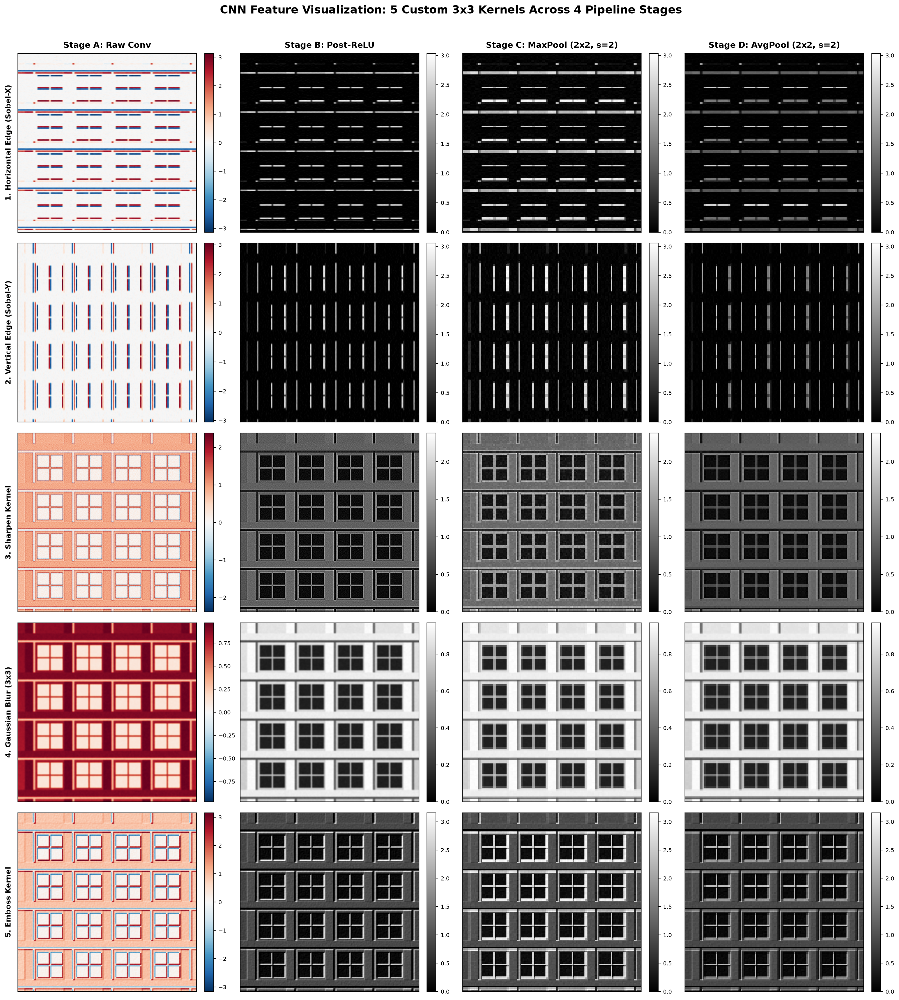

# Lab 12: CNN Feature Visualization, Parameter Audit & Critical Analysis

## Overview
This laboratory implements a visual inspection pipeline to observe how a Convolutional Neural Network (CNN) transforms raw image pixels into hierarchical feature maps across five custom `3x3` spatial filters and four sequential processing stages, followed by a manual parameter count audit and critical architectural analysis.

## Files
- [`lab12_cnn_visualization.py`](lab12_cnn_visualization.py) — Reproducible Python script executing Part I (5×4 feature visualization grid) and Part II (Model A vs. Model B TensorFlow/Keras parameter audit).
- [`visualizations/input_architecture.png`](visualizations/input_architecture.png) — High-contrast 256×256 architectural test image with crisp horizontal/vertical edges and recessed window grids.
- [`visualizations/part1_5x4_feature_grid.png`](visualizations/part1_5x4_feature_grid.png) — Unified 5×4 comparative visualization grid across all 5 filters and 4 stages.
- [`visualizations/part2_model_summaries.txt`](visualizations/part2_model_summaries.txt) — Raw `model.summary()` output from TensorFlow/Keras.

---

## Part I: Filter Pipeline & 5×4 Visualization Grid

Five `3×3` kernels were applied independently to the architectural test image across four stages:
- **Stage A:** Raw Convolution Output (linear feature map)
- **Stage B:** Post-ReLU Activation (`ReLU(x) = max(0, x)`)
- **Stage C:** Max Pooling (`2×2`, stride 2)
- **Stage D:** Average Pooling (`2×2`, stride 2)

| Filter (Row) | Stage A Range | % Negative (`< 0`) | Stage B `% == 0` | Stage C Mean | Stage D Mean |
| :--- | :---: | :---: | :---: | :---: | :---: |
| **1. Horizontal Edge (Sobel-X)** | `[-3.14, 3.03]` | 49.1% | 49.1% | 0.362 | 0.199 |
| **2. Vertical Edge (Sobel-Y)** | `[-3.04, 3.06]` | 48.6% | 48.6% | 0.261 | 0.176 |
| **3. Sharpen Kernel** | `[-1.47, 2.38]` | 14.4% | 14.4% | 0.895 | 0.662 |
| **4. Gaussian Blur (3×3)** | `[0.10, 0.97]` | 0.0% | 0.0% | 0.653 | 0.608 |
| **5. Emboss Kernel** | `[-2.84, 3.16]` | 13.4% | 13.4% | 1.012 | 0.782 |

---

## Part II: Architectural Comparison & Manual Parameter Audit

Both models process an RGB input of size `32 × 32 × 3`, followed by `Conv1` (5 filters), `Pool1` (`2×2`, stride 2), `Conv2` (10 filters), `Pool2` (`2×2`, stride 2), `GlobalAveragePooling2D`, and a 10-class `Dense` output layer.

**Formula:**
$$\text{Trainable Parameters per Conv Layer} = (K_h \times K_w \times C_{\text{in}} + 1) \times C_{\text{out}}$$

### Step-by-Step Manual Calculations

#### Model A (Standard: `3×3` Kernels, Max Pooling)
1. **Conv1** ($K_h=3, K_w=3, C_{\text{in}}=3, C_{\text{out}}=5$):
   $$(3 \times 3 \times 3 + 1) \times 5 = (27 + 1) \times 5 = 28 \times 5 = \mathbf{140}$$
2. **Pool1 (MaxPool 2×2, stride 2):** $\mathbf{0}$
3. **Conv2** ($K_h=3, K_w=3, C_{\text{in}}=5, C_{\text{out}}=10$):
   $$(3 \times 3 \times 5 + 1) \times 10 = (45 + 1) \times 10 = 46 \times 10 = \mathbf{460}$$
4. **Pool2 (MaxPool 2×2, stride 2):** $\mathbf{0}$
5. **GlobalAveragePooling2D:** $\mathbf{0}$ (outputs 10-dimensional vector)
6. **Dense Output (10 units):**
   $$(10 + 1) \times 10 = 11 \times 10 = \mathbf{110}$$
- **Total Model A Parameters:** $140 + 460 + 110 = \mathbf{710}$

#### Model B (Large Kernel: `5×5` Kernels, Average Pooling)
1. **Conv1** ($K_h=5, K_w=5, C_{\text{in}}=3, C_{\text{out}}=5$):
   $$(5 \times 5 \times 3 + 1) \times 5 = (75 + 1) \times 5 = 76 \times 5 = \mathbf{380}$$
2. **Pool1 (AvgPool 2×2, stride 2):** $\mathbf{0}$
3. **Conv2** ($K_h=5, K_w=5, C_{\text{in}}=5, C_{\text{out}}=10$):
   $$(5 \times 5 \times 5 + 1) \times 10 = (125 + 1) \times 10 = 126 \times 10 = \mathbf{1,260}$$
4. **Pool2 (AvgPool 2×2, stride 2):** $\mathbf{0}$
5. **GlobalAveragePooling2D:** $\mathbf{0}$ (outputs 10-dimensional vector)
6. **Dense Output (10 units):**
   $$(10 + 1) \times 10 = 11 \times 10 = \mathbf{110}$$
- **Total Model B Parameters:** $380 + 1,260 + 110 = \mathbf{1,750}$

### Audit Summary Table

| Model Configuration | Conv Architecture | Kernel Size | Pooling Type | Manual Count | Code Output |
| :--- | :--- | :---: | :--- | :---: | :---: |
| **Model A (Standard)** | Conv1: 5 filters Conv2: 10 filters | `3 × 3` | Max Pooling (`2 × 2`, stride 2) | **710** | **710** |
| **Model B (Large Kernel)** | Conv1: 5 filters Conv2: 10 filters | `5 × 5` | Avg Pooling (`2 × 2`, stride 2) | **1,750** | **1,750** |

---

## Part III: Critical Thinking & Viva Defense Questions (Handwritten Reference)

### Question 1 — The ReLU "Blackout" Effect & Activation Alternatives
- **Observation (Rows 1 & 2, Stage A vs. Stage B):**
  - In **Row 1 (Horizontal Edge / Sobel-X)**, **49.1%** of pixels became completely black (`0.00`) in Stage B. Specifically, the **top edges of dark window recesses** and **bottom edges of bright horizontal floor slabs** (light-to-dark downward transitions, shown in blue in Stage A down to `-3.14`) were zeroed out.
  - In **Row 2 (Vertical Edge / Sobel-Y)**, **48.6%** of pixels turned completely black in Stage B. Specifically, the **right edges of bright vertical pillars** and **left edges of dark window recesses** (light-to-dark rightward transitions, shown in blue in Stage A down to `-3.04`) were zeroed out.
- **Why those pixels held negative values:** Edge kernels have zero-sum weights (`[-1, -2, -1]` vs `[+1, +2, +1]`). When a bright region lies under the negative weights and a dark region lies under the positive weights, the dot product is strictly negative, encoding edge polarity (direction of intensity drop). `ReLU(x) = max(0, x)` clips all negative responses to `0`.
- **Leaky ReLU ($\alpha = 0.1$) vs. Sigmoid:**
  - **Leaky ReLU:** $f(x) = x$ if $x > 0$, else $0.1x$. Instead of turning black (`0`), the opposite-polarity edges remain faintly active (e.g., `-3.14` becomes `-0.314`), preserving negative gradient flow and preventing dead neurons.
  - **Sigmoid:** $\sigma(x) = \frac{1}{1 + e^{-x}} \in (0, 1)$. Flat/zero-gradient regions map to $\sigma(0) = 0.5$ (mid-gray instead of black), positive edges approach `1.0`, and negative edges approach `0.0`, compressing extreme contrast and causing vanishing gradients for $|x| \gg 0$.

---

### Question 2 — Max Pooling vs. Average Pooling Information Retention
- **Observation (Rows 1–3, Stage C vs. Stage D):**
  - Across **Row 3 (Sharpen)**, **Row 1 (Horizontal Edge)**, and **Row 2 (Vertical Edge)**, **Stage C (Max Pooling)** preserved the crisp high-frequency **window mullion crossbars**, **pillar/beam boundaries**, and **peak edge responses** (e.g., Sharpen mean `0.895`, Horizontal Edge mean `0.362`).
  - Under **Stage D (Average Pooling)**, these thin 1–2 pixel high-frequency strokes were washed out and dimmed because each bright edge pixel was averaged with neighboring zero/background pixels in its `2×2` window (dropping Sharpen mean to `0.662` and Horizontal Edge mean to `0.199`).
- **Dark Ink Text on Pure White Background (pixel values near 255):**
  - On a raw/inverted-contrast image where **background = 255 (white)** and **dark ink = ~0 (black)**, **Max Pooling** would select `255` from any `2×2` window containing both ink and white paper, **erasing the dark text strokes**!
  - **Average Pooling** would preserve the text strokes much better (producing intermediate gray values where strokes exist), or **Min Pooling** / **inverted intensity + Max Pooling** would be required to retain dark-on-light features.

---

### Question 3 — Parameter Explosion & Receptive Field Equivalence
- **Percentage Increase (Model A → Model B):**
  $$\text{Percentage Increase} = \frac{1,750 - 710}{710} \times 100\% = \frac{1,040}{710} \times 100\% = \mathbf{146.48\%}$$
  *(Comparing only convolutional layers: $600 \rightarrow 1,640$, an increase of $173.33\%$.)*
- **Receptive Field Equivalence with Stacked `3×3` Layers:**
  - **Number of `3×3` layers required:** **2 stacked `3×3` layers** (with stride 1). Layer 1 has a `3×3` receptive field; Layer 2 views a `3×3` patch of Layer 1, yielding an effective receptive field of $3 + (3 - 1) = \mathbf{5 \times 5}$.
  - **Parameters saved:**
    - For a general layer with $C$ input and $C$ output channels (ignoring bias):
      - One `5×5` layer: $5 \times 5 \times C^2 = \mathbf{25C^2}$ weights.
      - Two `3×3` layers: $2 \times (3 \times 3 \times C^2) = \mathbf{18C^2}$ weights.
      - **Savings:** $\frac{25C^2 - 18C^2}{25C^2} = \mathbf{28\%}$ fewer weights (plus an extra ReLU non-linearity between layers).
    - Applied to Model B's `Conv2` ($C_{\text{in}}=5, C_{\text{out}}=10$): replacing the single `5×5` `Conv2` (**1,260** params) with two stacked `3×3` layers (`5→10` then `10→10`, or `5→5` then `5→10`) yields `(45+1)*5 + (45+1)*10 = 230 + 460 = 690` params — saving **570 parameters (45.2%)** in `Conv2` alone.

---

### Question 4 — Operation Commutativity (Order Invariance)
- **Result:** The resulting output tensor is **IDENTICAL**. `Conv → ReLU → MaxPool` and `Conv → MaxPool → ReLU` produce the exact same output because $\text{ReLU}(x) = \max(0, x)$ is a **monotonically non-decreasing** function, so $\max_i(\max(0, x_i)) = \max(0, \max_i(x_i))$.
- **Mathematical Proof on a `2×2` Sample Patch:**
  Let $P = \begin{bmatrix} -4 & -1 \\ -3 & 2 \end{bmatrix}$:
  - **Path 1 (`ReLU → MaxPool`):**
    $$\text{ReLU}(P) = \begin{bmatrix} 0 & 0 \\ 0 & 2 \end{bmatrix} \implies \text{MaxPool} = \max(0, 0, 0, 2) = \mathbf{2}$$
  - **Path 2 (`MaxPool → ReLU`):**
    $$\text{MaxPool}(P) = \max(-4, -1, -3, 2) = 2 \implies \text{ReLU}(2) = \max(0, 2) = \mathbf{2}$$
  Even if all values are negative, e.g. $P' = \begin{bmatrix} -5 & -2 \\ -8 & -1 \end{bmatrix}$:
  - Path 1: $\text{MaxPool}(\begin{bmatrix} 0 & 0 \\ 0 & 0 \end{bmatrix}) = \mathbf{0}$.
  - Path 2: $\text{ReLU}(\max(-5, -2, -8, -1)) = \text{ReLU}(-1) = \mathbf{0}$.
- **Computational Efficiency Implication:**
  `Conv → MaxPool → ReLU` is **more computationally efficient**. Applying `2×2` stride-2 Max Pooling first reduces the spatial dimensions by **$4\times$** (e.g., $H \times W \rightarrow \frac{H}{2} \times \frac{W}{2}$), so ReLU only executes on **25% of the elements**, saving memory bandwidth and element-wise operations during both forward and backward passes.

---

### Question 5 — Diagnosing Filter Redundancy (Debugging Scenario)
1. **Root Cause 1 — Identical / Constant Weight Initialization (Symmetry):**
   - *Cause:* Initializing all 5 filters to the same constant (e.g., all zeros or identical values) means every filter computes the exact same forward activation and receives identical gradients during backpropagation, so they remain locked in symmetry forever.
   - *Fix:* Use variance-scaled random symmetry-breaking initialization such as **He (Kaiming) Normal/Uniform** (optimal for ReLU) or **Xavier/Glorot** initialization.
2. **Root Cause 2 — Excessive Learning Rate Causing Dying ReLUs / Gradient Collapse:**
   - *Cause:* A learning rate that is too large causes massive weight updates in early iterations, pushing pre-activations of multiple filters into the negative regime where `ReLU` outputs `0` and has `0` gradient ("Dying ReLU"), or causing filters to saturate onto the same dominant low-frequency direction.
   - *Fix:* Lower the learning rate (e.g., `1e-3` → `1e-4` with Adam/cosine decay), add **Batch Normalization** before ReLU, or replace ReLU with **Leaky ReLU / GELU**, and optionally add **orthogonal regularization** to encourage diverse filter orientations.
